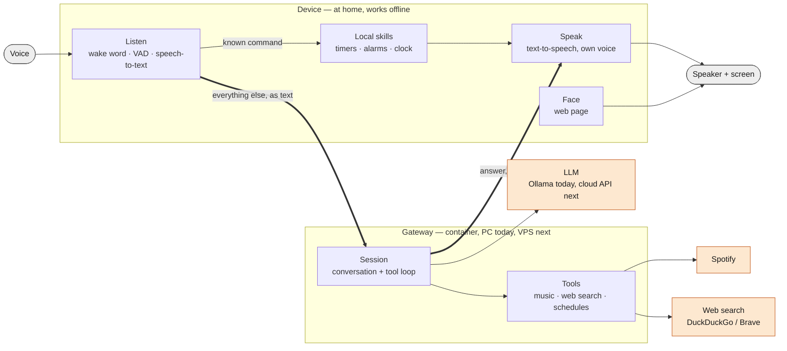
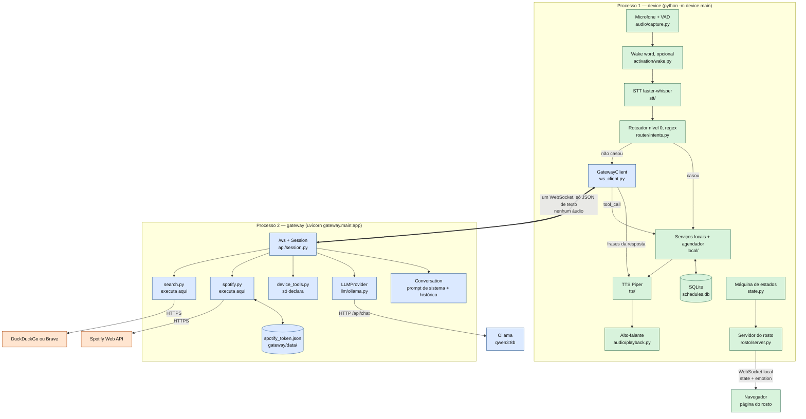

# Ideraldinho — portable voice assistant

Client-server voice assistant, built to replace a bedroom Alexa without giving
up portability. The device listens, transcribes and speaks locally; the gateway
holds the LLM, the secrets and the tools that need the internet.

Two non-negotiables from the plan: **two separate processes from the first
commit**, and **alarms and timers always execute on the device**.

Everything here runs on a PC today. There is no Pi yet, and no number in this
repository was measured on one.

## Architecture



A known command — timer, alarm, the time — never leaves the device. Everything
else goes up as text and comes back as text: audio never crosses the network.
Only the gateway talks to outside services.

<details>
<summary>The detailed view: every module in both processes</summary>



</details>

Seven more diagrams — one turn end to end, the wire protocol, the state
machine, the tool loop, deployment today and planned — are in
[`docs/arquitetura.md`](docs/arquitetura.md).

## Documentation

Start here, then follow the topic:

| Document | What it holds |
|---|---|
| [`docs/ultraplan-v3-assistente-voz-portatil.md`](docs/ultraplan-v3-assistente-voz-portatil.md) | the specification — never rewritten |
| [`docs/decisions.md`](docs/decisions.md) | where the build diverged from it, and why |
| [`docs/diario-de-bordo.md`](docs/diario-de-bordo.md) | the narrative: doubts, attempts, what broke |
| [`docs/repository-structure.md`](docs/repository-structure.md) | what each folder is for |
| [`docs/arquitetura.md`](docs/arquitetura.md) | the whole application in diagrams: processes, a turn, the protocol, deployment |

Per topic:

| Topic | Document |
|---|---|
| Offline timers, alarms, the intent router | [`docs/nivel-0-offline.md`](docs/nivel-0-offline.md) |
| Gateway, container, model choice, web search | [`docs/gateway-e-modelo.md`](docs/gateway-e-modelo.md) |
| Music: `tipo`, playlists, devices, scopes | [`docs/spotify.md`](docs/spotify.md) |
| Wake word: threshold, training, results | [`docs/wake-word.md`](docs/wake-word.md) |
| The face: themes, states, cost | [`docs/rosto.md`](docs/rosto.md) |
| Voice, speaker recognition, fine-tuning | [`docs/voz-e-locutor.md`](docs/voz-e-locutor.md) |
| Measured STT/TTS numbers | [`lab/RESULTS.md`](lab/RESULTS.md) |
| Every bench command and flag | [`lab/docs/comandos.md`](lab/docs/comandos.md) |

## Layout

```
device/      runs on the PC now, on a Pi later
  audio/         capture (mic + VAD), playback
  activation/    wake word, GPIO button, power-source detection
  router/        level-0 intent matching: regex + slot extraction
  local/         timers, alarms, the clock -- SQLite + scheduler, no network
  stt/           faster-whisper: transcription happens before the wire (D1)
  tts/           Piper: the assistant's own voice, synthesised locally
  rosto/         the face: web app served locally, state over WS (D27)
  ws_client.py   the single connection to the gateway
  state.py       state machine + the observer hook the face subscribes to
gateway/     runs with uvicorn today, in Docker on a VPS later
  api/           WebSocket, token auth, the turn loop
  llm/           interface + swappable implementations
  tools/         device_tools.py  declared here, executed on the device (D18)
                 spotify.py       executed here: this is where secrets live (D21)
                 search.py        web search, swappable provider (D24)
  conversation/  history and context assembly
  data/          the Spotify refresh token -- gitignored
common/      shared message schemas -- the contract, never logic
scripts/     dev tools; scripts/rosto.py drives the face without a microphone
lab/         bench for picking the STT and TTS engines (not production)
docs/        the plan, the decision log, the diary, the topic guides
.claude/     project skills: /documentar closes a work session
```

`docs/repository-structure.md` explains why each boundary is where it is.

## Setup

```powershell
Copy-Item .env.example .env
python -m venv .venv
.\.venv\Scripts\python.exe -m pip install -r requirements.txt
ollama pull qwen3:8b                    # the LLM the .env points at (D20)
```

`.env.example` documents every variable. The only ones without a safe default
are `DEVICE_TOKEN` and, if you want music, the two Spotify credentials —
everything else works as shipped, web search included.

Music needs one extra authorisation step: see [`docs/spotify.md`](docs/spotify.md).

## Running it

Every command assumes the project root as the working directory.

```powershell
ollama serve                                            # or the Ollama app
.\.venv\Scripts\python.exe -m uvicorn gateway.main:app  # terminal 2
.\.venv\Scripts\python.exe -m device.main               # terminal 3
```

You speak; the mic records until the VAD hears you stop; faster-whisper
transcribes **on the device**; the gateway asks Ollama and streams the answer
back one sentence at a time; Piper speaks it in the owner's own voice. No audio
crosses the network in either direction — only text (D1, D7, D13).

| Flag | What it does |
|---|---|
| `--text` | keyboard instead of microphone, and no STT loaded |
| `--verbose` | prints what was heard and how long each stage took |
| `--rosto` | opens the face in a browser too |

`--text` is the first debugging move: if the answer is wrong with typed input,
the problem is not the microphone.

Pick the microphone with `AUDIO_INPUT_DEVICE` (a name fragment is enough) —
whatever Windows picked by default is often a headset that is not plugged in,
and a silent recording looks exactly like a broken model.

If the gateway goes away mid-conversation, the device does not: it reconnects
with growing backoff and goes back to listening (D14). What it does not get back
is the answer to that turn — history lives in the gateway's session and dies with
the connection. A rejected token is the one failure that is not retried.

```powershell
.\.venv\Scripts\python.exe -m pytest
```

## What works today

| Phase | State | Where to read |
|---|---|---|
| 0 — the loop, end to end | wired; 10 clean turns still to verify with a real mic | this file |
| 1 — gateway in a container | written, **never executed**; first run will be on the VPS | [gateway](docs/gateway-e-modelo.md) |
| 2 — offline timers and alarms | done, verified by running it | [nível 0](docs/nivel-0-offline.md) |
| 3 — tools | done, minus Home Assistant (out of scope) | [gateway](docs/gateway-e-modelo.md), [spotify](docs/spotify.md) |
| 4 — the face | up on the PC; kiosk and the RTF measurement wait on a Pi | [rosto](docs/rosto.md) |
| 7 — wake word | trained and wired; ships off, threshold needs a real mic | [wake word](docs/wake-word.md) |

## What comes next

**Portable translator mode** is the next marker. Speak Portuguese, have the
device speak English or Chinese, and the reverse. Two of the three pieces exist
already — Whisper is multilingual by nature, Piper has a voice per language — so
what is missing is machine translation in the middle. The candidate is
**opus-mt on CTranslate2**, the same runtime `faster_whisper` already uses.
NLLB-200 600M is recorded as a quality ceiling and a **non-candidate on the
device**: it is autoregressive over 600M parameters on four ARM cores, which is
what ruled out a local LLM on day 1.

**The biggest open question is the hardware.** Every number so far was measured
on a PC. Moving from the bench to real device code already pushed RTF from 0.43
to 0.6–0.9, and a Pi is slower than both.

Everything **waiting on hardware** — measuring STT on the Pi, raspotify, ducking,
and the one `docker compose up` that has never run — is collected in a single
checklist at the end of [`docs/diario-de-bordo.md`](docs/diario-de-bordo.md), so
none of it has to be rediscovered.
