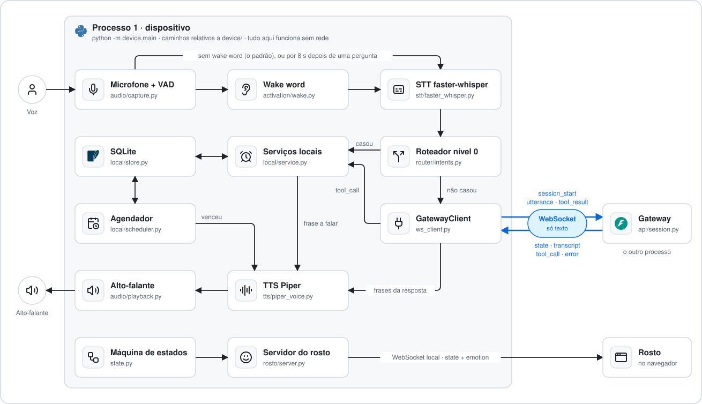
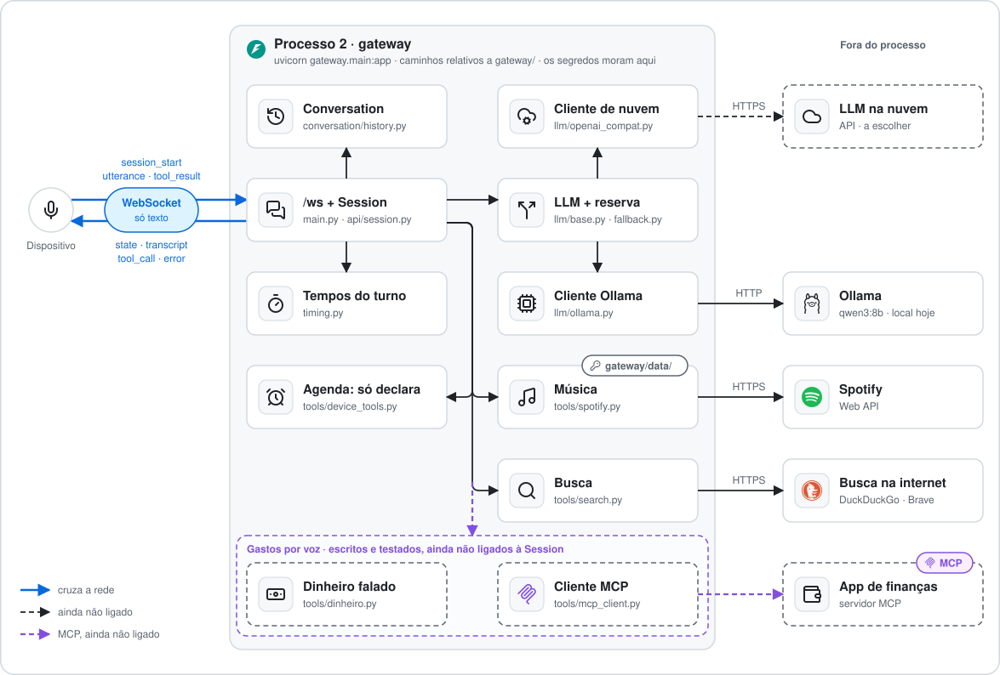
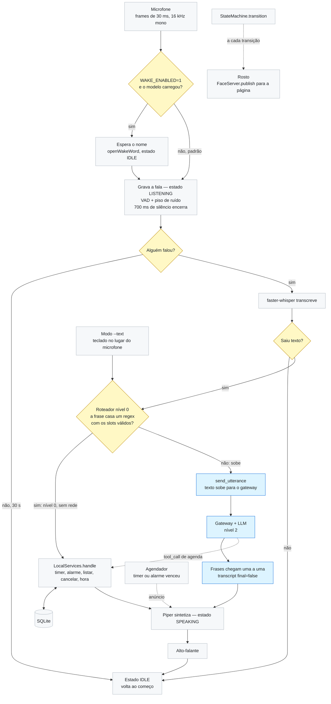
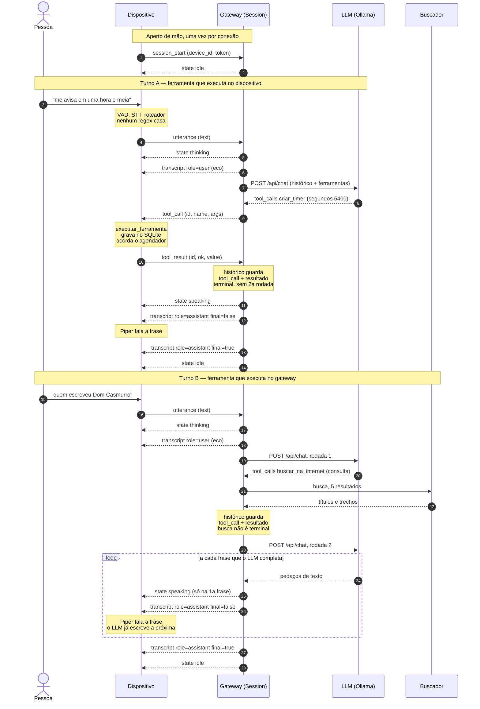
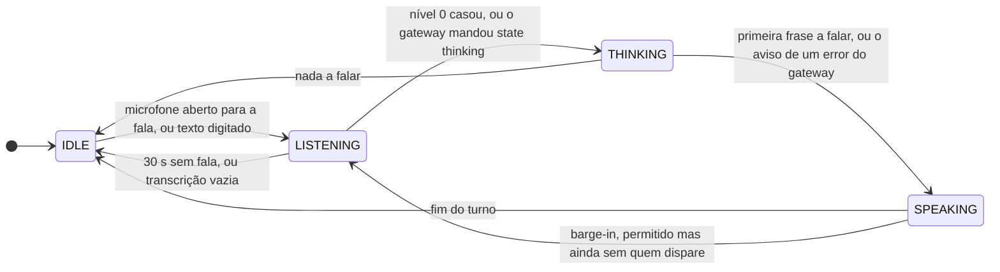
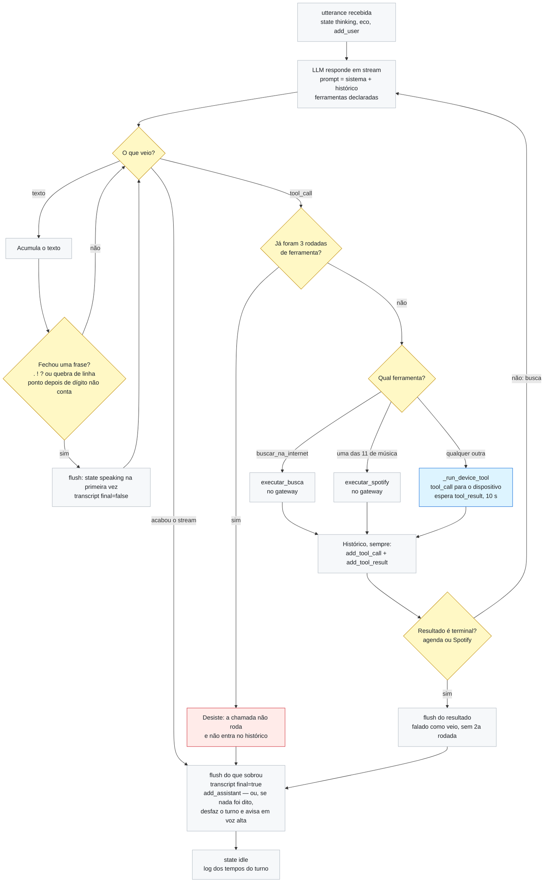
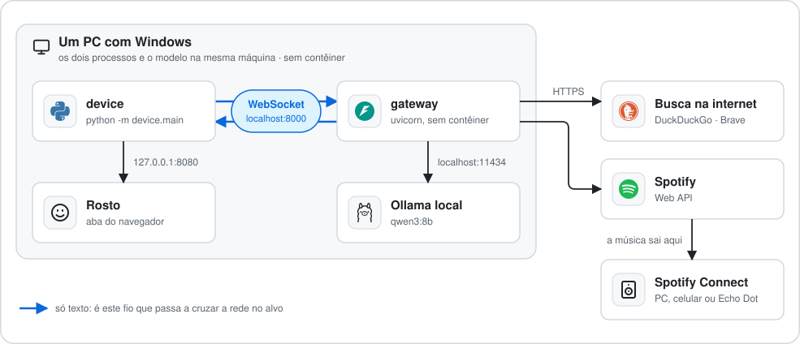
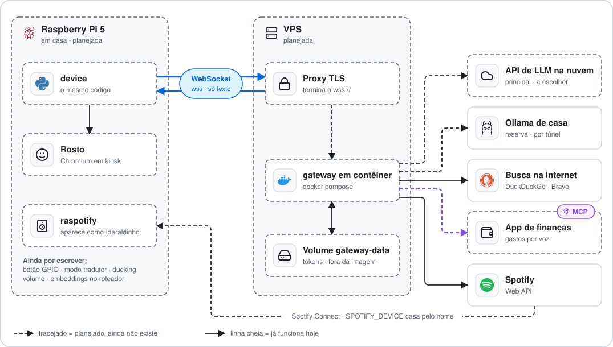
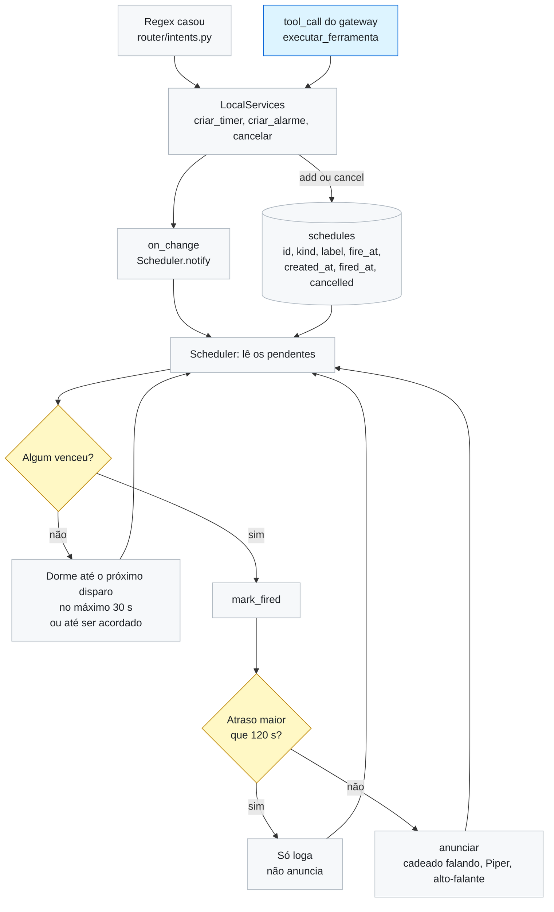
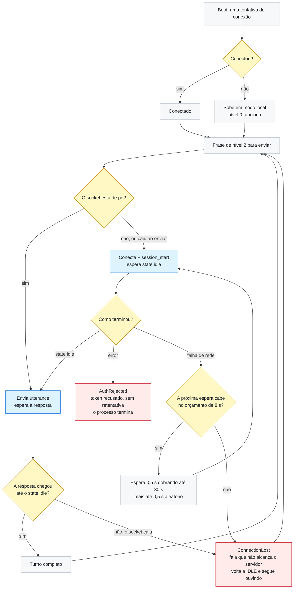

# Arquitetura em diagramas

Os outros documentos contam a história em prosa. Este desenha a aplicação
inteira: os dois processos, o caminho de um turno, o que passa pelo fio, a
máquina de estados, o laço de ferramentas e onde cada coisa roda.

Os diagramas foram tirados do código, não dos outros documentos. Quando eu
mudar `device/main.py`, `gateway/api/session.py` ou `common/messages.py`, é
aqui que o desenho tem que mudar junto.

Os desenhos de arquitetura e de implantação saem de
[`docs/diagramas/gerar.py`](diagramas/gerar.py), que escreve os SVG em
`docs/img/`. Sequência, estados e fluxogramas continuam em Mermaid, que é a
notação de costume para eles. Nos fluxogramas as cores dizem a mesma coisa que
nas figuras: cinza é passo local, amarelo é decisão, azul é o que cruza a rede
ou depende do gateway, vermelho é falha.

Decisões relacionadas: [D1](decisions.md), [D7](decisions.md),
[D13](decisions.md), [D14](decisions.md), [D17](decisions.md),
[D18](decisions.md), [D21](decisions.md), [D22](decisions.md),
[D23](decisions.md), [D24](decisions.md), [D27](decisions.md),
[D30](decisions.md).

Tudo aqui roda num PC hoje. Não há Pi, não há VPS, e a seção
[Implantação](#6-implantação-hoje-e-o-alvo) separa o que existe do que está
planejado.

---

## Em uma tela

Só os componentes e como se ligam: por onde a voz entra, o que fica em casa, o
que vai para o gateway e quais serviços de fora ele alcança. Os diagramas
seguintes abrem cada caixa.

**O que notar.** Um comando conhecido — timer, alarme, hora — nunca sai do
dispositivo. Todo o resto sobe como texto e volta como texto: o áudio não cruza
a rede em nenhum dos dois sentidos. E só o gateway fala com serviços de fora.

A caixa tracejada é a única ligação que ainda não está de ponta a ponta: o
cliente MCP existe e é testado contra um servidor falso; as ferramentas de
gasto por voz em cima dele são o próximo passo
([próximos passos](proximos-passos.md)).

---

## 1. Visão geral

Os dois processos abertos, módulo por módulo. O subtítulo de cada cartão é o
arquivo onde ele mora. São duas figuras porque numa só o texto ficaria pequeno
demais para ler; o que as liga é o WebSocket, que aparece nas duas.

**O dispositivo:**

**O gateway:**

As convenções são as mesmas da figura de cima: seta preta é chamada local ou
HTTP comum, seta azul grossa é o que cruza a rede, roxo é MCP, e tracejado é o
que ainda não está ligado de ponta a ponta.

O que notar:

- **Tudo dentro da zona do dispositivo funciona sem rede nenhuma.** Microfone,
  wake word, STT, roteador, timers e alarmes, TTS e rosto estão todos no mesmo
  processo. É por isso que ele liga e responde "que horas são" com o gateway
  desligado (D17).
- **O gateway precisa do LLM, mas não necessariamente da internet:** hoje o
  Ollama roda na mesma máquina. Spotify e busca, esses sim, são internet. Só o
  gateway fala com eles; o segredo do Spotify mora em `gateway/data/` e nunca
  desce (D21).
- **As setas azuis são a única coisa que cruza a rede** entre os dois
  processos: um WebSocket, com mensagens JSON de texto — os sete tipos escritos
  ao lado da pílula. O áudio nasce e morre no dispositivo (D7, D13). Se chegar
  um frame binário, os dois lados reclamam em vez de tocar.
- O `tool_call` volta pelo mesmo WebSocket e termina em `local/`, o mesmo
  código que o roteador de regex usa (D18). No gateway, `device_tools.py` só
  declara essas ferramentas: quem executa é o dispositivo.
- **O wake word tem um atalho por cima.** É o caminho padrão
  (`WAKE_ENABLED=0`) e também a janela de continuação: depois de uma pergunta
  do aparelho, ele ouve por 8 s sem exigir o nome (seção 4).
- **O LLM é um provedor, ou dois em fila.** Sem `LLM_FALLBACK_PROVIDER`, a
  Session fala com um cliente só — hoje, o do Ollama. Com reserva configurado,
  `fallback.py` tenta o principal e passa ao outro se ele não começar a
  responder a tempo. A seta para a nuvem é tracejada porque o cliente existe e
  é testado contra servidor falso, mas nenhum provedor foi escolhido e medido.
- **O grupo roxo tracejado existe e tem teste, mas a Session ainda não o
  chama.** `mcp_client.py` é o transporte MCP e `dinheiro.py` é o parser de
  valores e datas; as ferramentas de gasto por voz que juntam os dois são o
  próximo passo ([próximos passos](proximos-passos.md)).

### Onde mora cada coisa

| Caixa | Arquivo | O que faz |
|---|---|---|
| Microfone + VAD | `device/audio/capture.py` | stream aberto uma vez, frames de 30 ms, webrtcvad + piso de ruído |
| Wake word | `device/activation/wake.py` | openWakeWord em blocos de 80 ms; desligado por padrão |
| STT | `device/stt/faster_whisper.py` | transcreve o PCM, offline primeiro |
| Roteador nível 0 | `device/router/intents.py` | normaliza a frase e casa regex com slots |
| Serviços locais | `device/local/service.py` | timer, alarme, listar, cancelar, hora; devolve a frase a falar |
| Agendador | `device/local/scheduler.py` | dorme até o próximo disparo e chama o anúncio |
| SQLite | `device/local/store.py` | tabela `schedules`, em `device/data/schedules.db` |
| TTS | `device/tts/piper_voice.py` | Piper, um bloco de áudio por frase |
| Alto-falante | `device/audio/playback.py` | stream de saída aberto uma vez |
| Máquina de estados | `device/state.py` | transições legais + observadores |
| Servidor do rosto | `device/rosto/server.py` | HTTP estático e WebSocket na mesma porta, só em `127.0.0.1` |
| Página do rosto | `device/rosto/static/` | `minimo.html`, `anime.html`, `face.js` |
| GatewayClient | `device/ws_client.py` | a única conexão para fora; aperto de mão e reconexão |
| Laço do turno | `device/main.py` | amarra tudo acima; `executar_ferramenta` |
| `/ws` + Session | `gateway/main.py`, `gateway/api/session.py` | autenticação, turno, laço de ferramentas |
| Conversation | `gateway/conversation/history.py` | prompt de sistema e histórico aparado por turno inteiro |
| LLMProvider | `gateway/llm/base.py`, `ollama.py`, `openai_compat.py`, `fallback.py` | interface, Ollama em streaming, APIs no formato da OpenAI, e a queda para o reserva |
| device_tools | `gateway/tools/device_tools.py` | declara as 4 ferramentas de agenda e quais são terminais |
| spotify | `gateway/tools/spotify.py`, `spotify_auth.py` | 11 ferramentas de música, token e escopo |
| search | `gateway/tools/search.py` | `buscar_na_internet`, DuckDuckGo, Brave, leitor de página |
| Cliente MCP | `gateway/tools/mcp_client.py`, `financas_auth.py` | transporte MCP e autorização OAuth do app de finanças; ainda não ligado à Session |
| Dinheiro falado | `gateway/tools/dinheiro.py` | valor, data e confirmação por extenso, só funções puras; ainda não ligado à Session |
| Tempos do turno | `gateway/timing.py` | marca e loga cada etapa |
| Contrato | `common/messages.py`, `common/serialization.py` | os tipos de mensagem e o JSON |
| Contêiner | `gateway/Dockerfile`, `gateway/docker-compose.yml` | rodou em Linux em 21/11/2026 e roda no CI a cada push; falta a VPS e o modelo real (D16) |

---

## 2. O pipeline de um turno no dispositivo

O que notar:

- **O roteador vem antes da rede, sempre.** `answer()` em `device/main.py`
  tenta `match_intent` primeiro; só o que não casa vira `utterance`. Slot
  inválido derruba o casamento em vez de virar meia intenção: na dúvida, sobe.
- **Os dois caminhos acabam no mesmo Piper e no mesmo `LocalServices`.** Uma
  frase que o regex pega e uma que só o LLM entende executam o mesmo código
  (D18). O que muda é quem interpretou.
- **Wake word é um desvio opcional.** Com `WAKE_ENABLED=0`, que é o padrão, ou
  se o modelo não carregar, o aparelho ouve direto (D30).
- **O agendador fala por fora do turno.** Ele roda como tarefa no mesmo laço de
  eventos, e um cadeado (`falando`) impede o alarme de falar por cima de uma
  resposta.
- **O rosto não está no caminho do turno.** Ele assina a máquina de estados e
  recebe cada transição; se quebrar, vira linha de log (D27).
- Captura, STT e síntese bloqueiam, então rodam em threads
  (`asyncio.to_thread`) para o laço continuar atendendo o WebSocket.

---

## 3. Sequência de um turno de nível 2

Os nomes das mensagens são os de `common/messages.py`. São sete tipos no total:
`session_start`, `utterance` e `tool_result` sobem; `state`, `transcript`,
`tool_call` e `error` descem.

O que notar:

- **O gateway dirige o estado do dispositivo durante o nível 2.** `thinking`,
  `speaking` e `idle` chegam como mensagens `state` e o dispositivo aplica na
  própria máquina. O `idle` final é o que encerra o turno do lado de cá. Um
  `error` também encerra, dos dois lados, e é a última mensagem do turno: não
  vem `idle` depois dele, e o dispositivo fala uma frase fixa antes de voltar a
  `IDLE` — num aparelho sem tela, erro que só se imprime é silêncio.
- **`transcript` tem três usos.** `role=user` é o eco do que foi entendido;
  `role=assistant final=false` é uma frase para falar agora;
  `role=assistant final=true` é a resposta inteira, que o dispositivo não fala
  de novo.
- **`tool_call` e `tool_result` casam pelo `id`.** O gateway espera até 10 s
  pelo resultado e ignora o que não tiver o `id` da chamada atual.
- **No turno A o LLM é consultado uma vez só.** A frase que o dispositivo
  devolveu é a resposta (D18). No turno B são duas rodadas, porque a busca
  devolve material e não uma frase pronta (D24).
- **Spotify é igual ao turno B até a ferramenta, e igual ao A dali em diante:**
  o gateway executa, e a frase que o cliente devolve ("Tocando Construcao, de
  Chico Buarque.") vai ao ar sem segunda rodada (D21).
- O `state idle` do aperto de mão é consumido em `_await_ready`, fora de
  qualquer turno. `error` no lugar dele significa token recusado.

---

## 4. Máquina de estados do dispositivo

A tabela `ALLOWED` de `device/state.py`, com quem dispara cada transição hoje.

O que notar:

- **`IDLE` só vai para `LISTENING`.** Não existe atalho `IDLE → THINKING`; o
  nível 0 e o aviso de "servidor fora do ar" passam por `_ate_falar`, que anda
  estado por estado até `SPEAKING`.
- **Transição fora da tabela levanta `ValueError`.** A máquina é o lugar onde
  um erro de ordem aparece cedo.
- **Esperar o wake word é `IDLE`.** A máquina só sai dele quando a gravação da
  fala começa.
- **Uma pergunta abre uma janela, e não um estado novo.** Quando o turno termina
  numa pergunta — hoje, o "qual eu cancelo?" de um cancelamento ambíguo —, o
  `state idle` leva `expects_reply`, e o aparelho ouve por `REPLY_WINDOW_S`
  (8 s) sem exigir o nome. A resposta vai para quem perguntou: se foi o
  gateway, sobe direto, sem passar pelo roteador de nível 0 — senão um
  "cancela" cancelaria um timer. Silêncio na janela, e ele volta a esperar o
  nome sem dizer nada. Quem liga a janela é o código que sabe que perguntou;
  um "?" no texto do modelo não basta, ou cada "posso ajudar em mais alguma
  coisa?" deixaria o microfone aberto.
- **`SPEAKING → LISTENING` está na tabela e ninguém usa.** É a porta do
  barge-in; hoje o microfone descarta o que entrou enquanto o aparelho falava.
- **Emoção é um segundo eixo, não um estado.** `set_emotion` muda o humor sem
  mexer no ciclo, e cada mudança avisa os observadores. Nada no caminho do
  turno a preenche ainda: o rosto fica em `neutral`.

---

## 5. O laço de ferramentas do gateway

`Session._speak_response` em `gateway/api/session.py`. É o que a D25 chama de
"as 40 linhas".

O que notar:

- **O despacho é por nome, em três ramos.** Busca e Spotify executam no
  gateway; tudo o mais vira `tool_call` e atravessa o fio. Uma ferramenta que o
  modelo inventou cai no terceiro ramo, e é o dispositivo que responde
  "ferramenta desconhecida".
- **Terminal quer dizer "a frase já está pronta".** As quatro de agenda
  (`TERMINAL_TOOLS`) e todas as do Spotify vão ao ar como voltaram. O modelo
  reescrevendo uma lista perdia item (D18). Só a busca volta para o LLM.
- **O histórico guarda o par `tool_call` + resultado, inclusive nas
  terminais.** O pedido entra como mensagem `assistant` com `tool_calls`, o
  resultado como papel `tool`. Sem isso o modelo para de chamar ferramenta no
  turno seguinte e passa a narrar ação que não fez (D22). Os dois carregam o
  mesmo id — o do provedor, ou um gerado aqui —, que é o que uma API de nuvem
  exige para casar um com o outro. O Ollama recebe o par sem id, de propósito:
  foi nesse formato que a D22 mediu.
- **O histórico é aparado por turno inteiro.** Ele sempre começa num `user` e
  nunca separa uma chamada do seu resultado.
- **Há teto.** `MAX_TOOL_ROUNDS = 3`: no quarto pedido de ferramenta dentro do
  mesmo turno o laço desiste em vez de deixar o aparelho preso em `THINKING`.
  A chamada que não rodou não deixa rastro; e um turno que termina sem nada
  dito — este, ou uma resposta vazia do modelo — é desfeito por inteiro, e a
  pessoa ouve "não consegui responder a isso" em vez de silêncio.
- **Falha de ferramenta é texto, não exceção.** Timeout do dispositivo, erro do
  Spotify e busca fora do ar voltam como "falhou: ..." ou como uma frase
  falável. Isso vale para o erro esperado; o inesperado — um defeito dentro da
  ferramenta — é capturado na sessão, registrado com o traceback, guardado no
  histórico como falha do par e dito em voz alta. A sessão continua.
- **Nenhuma falha é muda, e cada uma tem a sua frase.** Modelo fora do ar,
  resposta vazia, ferramenta quebrada, mensagem malformada e gateway
  inalcançável são ditos com frases diferentes, e nenhum caminho fala a mesma
  falha duas vezes. Sem reserva configurado, um pedido ao modelo que falha
  rápido e antes da primeira palavra é repetido uma vez (`LLM_RETRIES`).
- **Ferramenta que não pode ser usada não é declarada.** Sem credenciais ou sem
  refresh token, as de música somem da lista; com `SEARCH_PROVIDER=none`, a de
  busca também (D19).

---

## 6. Implantação: hoje e o alvo

Dois desenhos. No segundo, borda tracejada quer dizer **planejado, não existe
ainda** — e lá quase tudo é tracejado. Linha cheia é o que já funciona hoje:
as setas cheias do segundo desenho são caminhos de código que não mudam com a
mudança de máquina.

**Hoje:**

**O alvo:**

O que notar:

- **Migrar é trocar `GATEWAY_URL`.** O dispositivo conhece um endereço só, e
  nenhum import cruza de `device/` para `gateway/`. O contêiner copia apenas
  `common/` e `gateway/`.
- **O contêiner já rodou, mas não aqui** (D16): em Linux, em 21/11/2026, e no
  CI a cada push. No PC o gateway continua subindo com `uvicorn`. O compose
  resolve o Ollama por `host.docker.internal` e guarda o token do Spotify num
  volume. Falta a VPS, e falta o modelo de verdade do outro lado.
- **A música hoje não sai do Ideraldinho.** `SPOTIFY_DEVICE=Ideraldinho` não
  casa com nenhum aparelho, então a escolha cai para o que estiver ativo na
  conta. Quando o raspotify existir na Pi com esse nome, a mesma configuração
  passa a tocar nela (D23).
- **Não existe ainda:** a Pi, a VPS e o proxy TLS na frente dela, um LLM de
  nuvem escolhido e medido (o cliente existe, testado só contra servidor
  falso), o túnel que deixa o Ollama de casa de reserva, o botão GPIO,
  o modo tradutor, ducking, volume e a similaridade por embeddings no roteador.
  A lista do que espera hardware está no fim do
  [diário de bordo](diario-de-bordo.md).

---

## 7. Timers e alarmes: o caminho que não depende de nada

O nível 0 sozinho, com o agendador. É a parte que tem que funcionar com a
internet caída.

O que notar:

- **O agendamento vive em disco**, com `fire_at` em epoch. Reiniciar o processo
  não perde alarme; o agendador relê o banco ao subir.
- **Criar ou cancelar acorda o agendador na hora.** Sem o `notify`, um timer de
  5 segundos esperaria a soneca de 30.
- **A soneca tem teto de 30 s** para o caso de o relógio ser corrigido no meio,
  que é o que acontece numa Pi sem RTC.
- **Alarme muito atrasado não toca.** Vencido há mais de 120 s com o aparelho
  fora do ar, ele é marcado como disparado e fica calado.
- O gateway não aparece neste desenho a não ser como uma das duas entradas. Ele
  nunca é responsável por acordar ninguém.

---

## 8. Quando o fio cai

`GatewayClient` em `device/ws_client.py`.

O que notar:

- **A reconexão mora no envio, não na recepção** (D14). Enquanto o gateway está
  fora, o aparelho continua ouvindo e resolvendo nível 0; só tenta de novo
  quando há uma frase de verdade para entregar.
- **Quem está esperando resposta espera no máximo 8 s** (`CONNECT_BUDGET`).
  Depois disso o aparelho diz "Nao consigo falar com o servidor agora. Timer e
  alarme continuam funcionando." e volta a ouvir.
- **O turno perdido não volta.** O histórico vive na `Session` do gateway, que
  morre com a conexão; a sessão nova começa sem memória.
- **Token errado é o único erro que não entra em retentativa.**
- A página do rosto tem a sua própria reconexão, em `face.js`: espera de 400 ms
  dobrando até 5 s, e o rosto apaga enquanto o servidor não volta.
